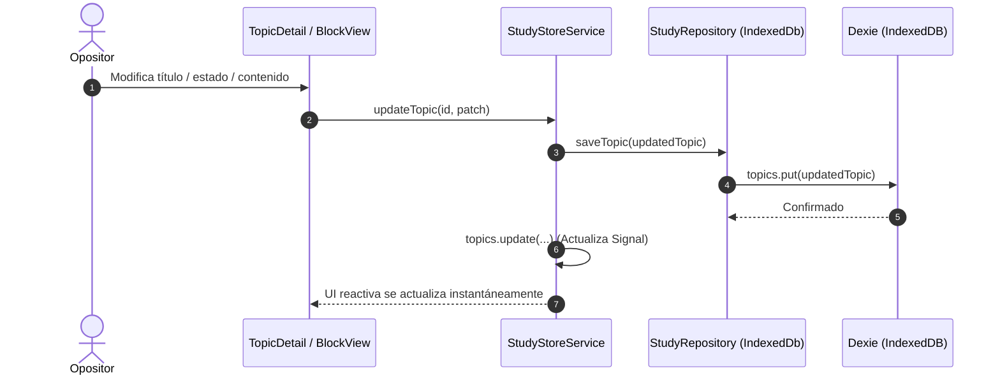

# ARCHITECTURE.md — Arquitectura del Sistema TAI Study

Este documento describe la arquitectura de software, los patrones de diseño, el flujo de datos y las estrategias de almacenamiento de **TAI Study**.

---

## 🏛️ 1. Visión Arquitectónica General

TAI Study sigue una arquitectura **Clean Client-Side** desacoplada mediante interfaces de repositorio y reactividad pura basada en **Angular Signals**. Toda la lógica de negocio y persistencia se ejecuta en el navegador del usuario (**Local-First**).

```mermaid
flowchart TD
    subgraph UI["Capa de Presentación (Angular 22)"]
        Shell["AppShell Component\n(Sidebar, Header, Search)"]
        Dashboard["Dashboard Component"]
        BlockView["BlockView Component\n(Topic List & Drag-Drop)"]
        TopicDetail["TopicDetail Component\n(Editor, Metadata, Outline)"]
        ComingSoon["ComingSoon Component\n(Fases 2, 3, 4)"]
    end

    subgraph State["Capa de Estado Reactivo"]
        Store["StudyStoreService\n(Signals: blocks, topics, searchQuery)"]
        Backup["BackupService\n(Export/Import JSON)"]
        Theme["ThemeService\n(Light/Dark Mode)"]
    end

    subgraph Domain["Capa de Dominio & Abstracción"]
        RepoToken["InjectionToken: STUDY_REPOSITORY"]
        RepoInterface["Interface: StudyRepository"]
        Models["Domain Models\n(TaiBlock, Topic, Status, Backup)"]
    end

    subgraph Storage["Capa de Persistencia Local"]
        RepoImpl["IndexedDbStudyRepository"]
        DexieDB["StudyDatabase (Dexie.js)"]
        BrowserIDB[("IndexedDB del Navegador\n'TaiStudyDB'")]
        DiskJSON[("Archivo Backup\n.json")]
    end

    Shell --> Store
    Dashboard --> Store
    BlockView --> Store
    TopicDetail --> Store
    ComingSoon --> Store

    Shell --> Backup
    Shell --> Theme

    Store --> RepoToken
    Backup --> RepoToken
    RepoToken -.-> RepoInterface
    RepoInterface <|.. RepoImpl

    RepoImpl --> DexieDB
    DexieDB --> BrowserIDB
    Backup --> DiskJSON
```

---

## 🧩 2. Estructura de Capas

### 2.1. Capa de Presentación (`src/app/features/` & `src/app/shared/`)

- **Componentes Standalone:** Cada vista es un componente standalone con lazy-loading en `app.routes.ts`.
- **Inyección Unidireccional:** Los componentes inyectan `StudyStoreService` para leer datos mediante Signals calculadas (`computed()`) y disparar mutaciones mediante métodos del store (`createTopic()`, `updateTopic()`, `reorderTopics()`, `deleteTopic()`).
- **Diseño Adaptable (Responsive):** Clases utilitarias de Tailwind v4 combinadas con Angular Material para modales y notificaciones (`MatDialog`, `MatSnackBar`).

### 2.2. Capa de Estado Reactivo (`src/app/core/services/`)

- **`StudyStoreService`:** Es el único punto de contacto para la UI sobre el estado global de la app.
  - Señales primarias:
    - `blocks = signal<TaiBlock[]>([])`
    - `topics = signal<Topic[]>([])`
    - `studySessions = signal<StudySession[]>([])`
    - `weeklyPlanItems = signal<WeeklyPlanItem[]>([])`
    - `searchQuery = signal('')`
    - `loading = signal(false)`
    - `initialized = signal(false)`
  - Señales derivadas (`computed`):
    - `totalTopics`, `masteredTopics`, `totalRoundsCompleted`.
    - `topicCountByBlock`: mapa de recuento de temas por cada uno de los 4 bloques.
    - `rustyTopics`: temas oxidados/críticos ordenados por urgencia de repaso.
    - `studyMinutesThisWeek`, `studyMinutesByBlockThisWeek`, `studyMinutesByBlockTotal`.
    - `filteredTopics`: filtrado en memoria por búsqueda sobre título, texto plano o etiquetas.
- **`PomodoroService`:** Temporizador global con Signals persistente durante la navegación entre vistas; guarda automáticamente `StudySession` al finalizar bloques de enfoque y actualiza `lastReviewedAt`.
- **`BackupService`:** Orquesta la exportación de la base de datos a un archivo descargable `tai-study-backup-YYYY-MM-DD.json` con `schemaVersion: 2` (retrocompatible con backups `v1`), validando esquemas durante la restauración.
- **`ThemeService`:** Persiste y conmuta el modo visual (`light` / `dark`) actualizando la clase CSS en el elemento raíz `<html>`.

### 2.3. Capa de Repositorio y Dominio (`src/app/core/repositories/` & `src/app/core/models/`)

- **Abstracción:** Se define la interfaz `StudyRepository`:
  ```ts
  export interface StudyRepository {
    initialize(): Promise<void>;
    getBlocks(): Promise<TaiBlock[]>;
    getTopics(blockId?: TaiBlockId): Promise<Topic[]>;
    getTopicById(id: string): Promise<Topic | undefined>;
    saveTopic(topic: Topic): Promise<void>;
    saveTopics(topics: Topic[]): Promise<void>;
    deleteTopic(id: string): Promise<void>;
    replaceAllData(blocks: TaiBlock[], topics: Topic[]): Promise<void>;
  }
  ```
- **Injection Token:** `STUDY_REPOSITORY` permite sustituir con facilidad la implementación real por un repositorio en memoria (`MockStudyRepository`) en pruebas unitarias, o un futuro `CloudStudyRepository` para sincronización en la nube (Fase 5).

### 2.4. Capa de Persistencia (`src/app/core/db/`)

- **Dexie.js (`StudyDatabase`):** Extiende de `Dexie` creando la base de datos `TaiStudyDB`.
- **Esquema Actual (Versión 3):**
  ```ts
  this.version(3).stores({
    blocks: 'id, order',
    topics: 'id, blockId, order, status, updatedAt, lastReviewedAt, *tags',
    studySessions: 'id, topicId, blockId, startedAt, type',
    weeklyPlanItems: 'id, weekStartDate, [weekStartDate+dayOfWeek], topicId, blockId',
    caseStudies: 'id, blockId, updatedAt, *tags',
    questions: 'id, blockId, topicId, caseStudyId, flagged, updatedAt, *tags',
    examAttempts: 'id, date, mode, caseStudyId',
  });
  ```
- **Seeding Automático:** Al iniciar la app (`initialize()`), si la tabla `blocks` está vacía, se inyectan automáticamente los **4 Bloques Oficiales TAI** definidos en `tai-seed.ts`.
- **Persistencia Robusta:** Invoca `navigator.storage.persist()` para pedir al navegador que marque el almacenamiento como persistente, evitando desalojos por baja memoria.

---

## 🔄 3. Ciclo de Vida de los Datos y Flujo de Operaciones

### Flujo de Creación / Actualización de un Tema



---

## 🛡️ 4. Estrategia Offline y PWA

1. **Service Worker (@angular/service-worker):**
   - Configurado en `ngsw-config.json`.
   - Estrategia de recursos estáticos: `prefetch` para los bundles JavaScript, CSS, HTML principal e iconos SVG.
2. **Web App Manifest (`public/manifest.webmanifest`):**
   - Nombre: `TAI Study — Oposiciones TAI`
   - Modo de visualización: `standalone` (sin barras del navegador).
   - Color de tema: `#2563eb` (azul primario).
   - Totalmente instalable en macOS, Windows, Linux, iOS y Android.

---

## 🧪 5. Arquitectura de Testing

- **Ejecutor:** Vitest v5 integrado en Angular CLI (`@angular/build:unit-test`).
- **Aislamiento de Pruebas:**
  - Los tests de componentes y servicios nunca tocan IndexedDB directamente.
  - Implementan un `MockStudyRepository` en memoria que simula la persistencia.
  - La suite se ejecuta en menos de 1 segundo de forma totalmente desacoplada del sistema operativo o el navegador físico.
